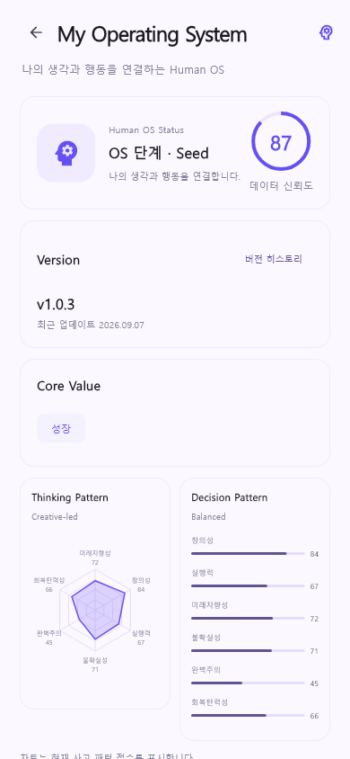

# MindBuilder · 기록과 AI 추천을 연결한 개인 실험

**질문과 기록을 바탕으로 다음 행동을 정리하는 앱을 실험했습니다.**

Flutter · FastAPI · PostgreSQL · OpenRouter



저장소에 보관된 화면 미리보기입니다.

## 시작한 이유

AI를 질문에 답하는 용도 외에 어떻게 쓰면 좋을지 궁금했습니다. 생각은 많지만 무엇부터 실행해야 할지 정리하기 어려웠던 경험에서 '나의 성장을 위한 인간 운영체제'라는 아이디어를 떠올렸습니다.

## 구현한 구조

| 단계 | 구성 |
| --- | --- |
| 입력·기록 | 질문에 대한 답변과 사용자 기록 저장 |
| 분석 | 점수·규칙을 이용해 단계별 정보 구성 |
| 추천 | 정리된 정보를 LLM 요청에 연결 |
| 화면 | 분석과 추천 결과 표시 |

기능 구성과 앱·서버 연동을 개인으로 진행했고, 분석 규칙과 점수 초안에는 AI를 활용했습니다.

## 개발하며 고민한 점

처음에는 'AI가 나를 분석해 주면 좋겠다'는 넓은 구상이었습니다. 이를 프로그램으로 옮기면서 입력·저장·분석·추천을 나누고, 코드가 처리할 부분과 LLM에 요청할 부분을 구분했습니다.

추천 문장만 생성하는 것보다 어떤 기록을 근거로 전달할지가 중요하다고 생각했습니다. 이 프로젝트는 **LLM에 전달할 정보와 처리 단계를 설계해 본 경험**을 남긴 개인 실험입니다.

## 현재 상태

프로토타입 단계입니다. 화면 테스트에서는 고정된 fixture 데이터를 사용하는 경우도 있어, 미리보기 점수는 실제 사용자 분석 결과와 구분합니다. 전체 흐름의 통합 검증과 분석 기준 정리는 더 진행해야 합니다.

[LLM 호출·응답 처리](backend/app/ai/llm) · [추천 생성](backend/app/ai/recommendation) · [화면 테스트](frontend/test/hos_page_test.dart)

## 실행 방법

<details>
<summary><b>⚙️ 환경변수 · 실행 방법</b></summary>

## 환경변수

### Backend

프로젝트 실행을 위해 `backend/.env`에 다음 설정이 필요합니다.

```env
POSTGRES_USER=mindbuilder_user
POSTGRES_PASSWORD=
POSTGRES_SERVER=localhost
POSTGRES_PORT=5432
POSTGRES_DB=mindbuilder

SECRET_KEY=
ALGORITHM=HS256

OPENROUTER_API_KEY=
OPENROUTER_BASE_URL=https://openrouter.ai/api/v1
OPENROUTER_MODEL=nvidia/nemotron-3-ultra-550b-a55b:free
```

> API Key와 Secret 값은 Repository에 Commit하지 않습니다.

## 실행 방법

### Backend

### 1. Clone

```bash
git clone https://github.com/EddieEom/MindBuilder.git
cd MindBuilder/backend
```

### 2. Virtual Environment

#### Windows

```bash
python -m venv venv
venv\Scripts\activate
```

#### macOS / Linux

```bash
python3 -m venv venv
source venv/bin/activate
```

### 3. Dependencies

```bash
pip install -r requirements.txt
```

### 4. Database Migration

```bash
alembic upgrade head
```

### 5. Run

```bash
uvicorn app.main:app --reload
```


### Frontend

```bash
cd ../frontend
flutter pub get
flutter run
```

Backend Server 주소는

```text
frontend/lib/core/config/api_config.dart
```

에서 개발 환경에 맞게 설정합니다.

</details>

